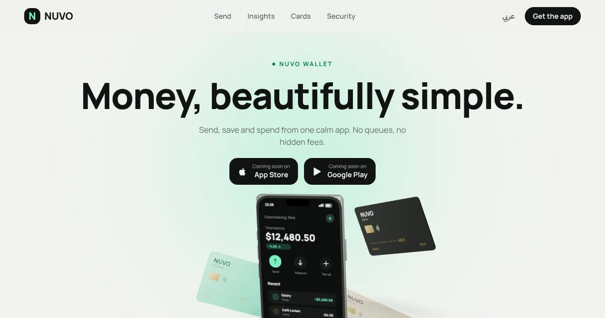

# NUVO Wallet — 3D Fintech App Launch

A launch page for a digital wallet app, built around a 3D phone that moves as you scroll.

**Live:** [nuvo-wallet.vercel.app](https://nuvo-wallet.vercel.app) · Part of my [portfolio](https://aya-khamaysa-portfolio.vercel.app)



## Highlights

- **A live app inside the phone:** the screen is drawn in real time: the balance counts up, an amount is typed and sent, charts grow, a card freezes, Face ID scans.
- **Scroll story:** the phone turns and glides for each feature (Send, AI insights, Cards, Security).
- **3D bank cards** float around the phone, then fan out in the Cards section.
- Drag to turn, English / Arabic (RTL, the app screens too), waiting-list form, no 3D files to download.

## Built with

React · Three.js · React Three Fiber · drei · Canvas 2D · Framer Motion · Tailwind CSS · Vite

## Run locally

```bash
npm install
npm run dev
```

## Edit
- Texts (page and app screens, English / Arabic): `src/data/ui.js`
- The app screens drawn inside the phone: `src/components/screens.js`
- Where the phone stands in each section: `src/components/Stage.jsx` (`POSES`)

> NUVO is a fictional app for a portfolio concept.

---

Designed & built by **Aya Khamaysa** · [Portfolio](https://aya-khamaysa-portfolio.vercel.app) · [LinkedIn](https://www.linkedin.com/in/ayakhamaysa) · [One Click](https://www.instagram.com/oneclick.ps)
